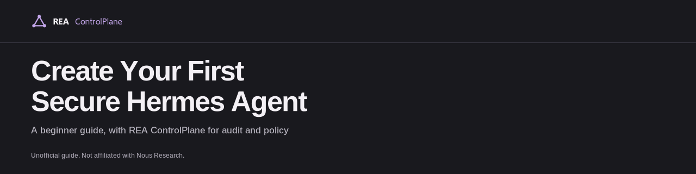

# Create Your First Secure Hermes Agent

> This is an unofficial guide. It is not affiliated with, endorsed by, or sponsored by Nous Research. "Secure" here describes the setup goal, not a guarantee.

A plain-language starter guide for setting up a personal Hermes agent with safety in mind, and connecting it to REA ControlPlane to review model-call activity and apply configured controls. REA does not sandbox local commands or file edits.

This guide is written for people who have never run an agent before. If you can open a terminal on macOS, Linux, or Windows (through WSL), you have what you need to begin. Take it one step at a time. Nothing here asks you to rush.

## What is Hermes?

Hermes Agent is an open-source agent project from Nous Research. You can read about it in its own words on the [official repository](https://github.com/NousResearch/hermes-agent). This guide does not replace the project's own documentation; it walks you through it in order and points you back to the original source at each step.

## What is REA ControlPlane?

REA ControlPlane is a product of REA Research Labs, Inc. It sits between your agent and your model vendor. You keep your own model and your own vendor key. For the current, official description, see [reacontrolplane.com](https://reacontrolplane.com).

In plain terms, it gives you three controls:

- **PreFlight** checks requests against configured rules before they reach your model vendor.
- **TraceGuard** covers tool-call controls and call records.
- **LoopGuard** is aimed at reducing repeated work and cost.

This guide does not walk through configuring these controls. See [reacontrolplane.com](https://reacontrolplane.com) for current details.

Your vendor key travels with each call and, according to the live site, is used only to make that call and is not stored. Your REA key is separate.

## Before you start: what you'll need

- A computer running macOS, Linux, or Windows with WSL.
- Comfort opening a terminal and pasting a command.
- An API key from a model vendor you already use.
- A REA ControlPlane key, if you want to complete the REA step. See [reacontrolplane.com](https://reacontrolplane.com) for current plan and trial details.
- About half an hour, and somewhere to keep your keys private (a password manager works well).

Platform notes are in [docs/installation.md](docs/installation.md).

## The path, step by step

1. **Install Hermes.** See [docs/installation.md](docs/installation.md).
2. **Have your first chat and try a first skill.** See [docs/first-chat-and-skill.md](docs/first-chat-and-skill.md).
3. **Set it up with safety in mind.** See [docs/safety.md](docs/safety.md).
4. **Connect REA ControlPlane.** See [docs/rea-controlplane.md](docs/rea-controlplane.md).
5. **Check that it works.** The REA doc above includes a simple check, so you can confirm calls are flowing through REA before you rely on it.

Each doc keeps the commands in one place, so this page stays readable and the steps stay accurate.

## Safety habits worth keeping

These are good habits, not guarantees. No setup makes an agent perfectly safe, and this guide does not promise that.

- Keep your keys out of shared files, screenshots, and chat messages.
- Enable only the tools you need, and add more only when you understand why the agent needs them.
- Remember that by default Hermes runs as your own user account, with that account's access. For stronger isolation, see the project's own documentation.
- If something looks wrong, stop the agent first and investigate second.

More detail is in [docs/safety.md](docs/safety.md).

## If something goes wrong

- **Hermes will not install or start:** see the troubleshooting notes in [docs/installation.md](docs/installation.md), and the project's own [issues page](https://github.com/NousResearch/hermes-agent/issues).
- **Calls fail after connecting REA:** see [docs/rea-controlplane.md](docs/rea-controlplane.md). Common causes are a mistyped key or a key in the wrong place.
- **A call was refused or contained:** that may be a control working as set. Check your rules and tool list before changing anything.

## Next steps

- Review REA ControlPlane's current controls at [reacontrolplane.com](https://reacontrolplane.com).
- Revisit [docs/safety.md](docs/safety.md) whenever you add a new skill or tool.

## Validation status

On Linux, Hermes v0.23.0 completed three `gpt-4o-mini` model-hop turns using the non-interactive CLI with tools disabled. The test used a fresh temporary home directory, not a new OS user account. Those calls were then manually confirmed in the REA console by the account owner. Interactive sessions, agent tools, macOS, and WSL have not been tested.

## About this guide

Written by REA Research Labs, Inc. Hermes Agent is a project of Nous Research; REA is not affiliated with it, and its name is used only to identify the software this guide describes. Product details for REA ControlPlane follow [reacontrolplane.com](https://reacontrolplane.com) as of November 7, 2026, and may change. When this guide and an original source disagree, trust the original source.

Original guide text is copyright © 2026 REA Research Labs, Inc. and licensed under [CC BY 4.0](LICENSE). Logos, banners, social previews, other artwork, and trademarks are excluded; see [LICENSE-SCOPE.md](LICENSE-SCOPE.md).
